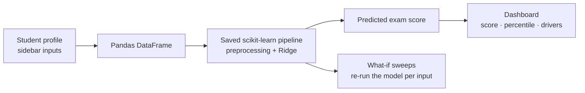

<div align="center">

# 🎓 StudentScore AI

**Predict student exam scores — and understand what moves them.**

An interactive machine learning app built with Python, scikit-learn and Streamlit.

[](https://student-score-ai.streamlit.app/)
[](https://www.python.org/)
[](https://scikit-learn.org/)

[**🚀 Live Demo**](https://student-score-ai.streamlit.app/) · [**💻 Source Code**](https://github.com/AbdelrhmanAkl/student-score-ai) · [**🐞 Report an Issue**](https://github.com/AbdelrhmanAkl/student-score-ai/issues)

<br>

<!-- Replace with a real screenshot: save it as assets/preview.png -->


</div>

---

## Table of Contents

- [Overview](#overview)
- [Features](#features)
- [Screenshots](#screenshots)
- [Tech Stack](#tech-stack)
- [Dataset](#dataset)
- [How It Works](#how-it-works)
- [Model](#model)
- [Project Structure](#project-structure)
- [Getting Started](#getting-started)
- [Deployment](#deployment)
- [Customization Notes](#customization-notes)
- [Limitations & Responsible Use](#limitations--responsible-use)
- [Roadmap](#roadmap)
- [Author](#author)

---

## Overview

Academic performance depends on many factors at once: study habits, attendance, sleep, family support, school environment and more. **StudentScore AI** turns a trained regression pipeline into a practical browser experience: describe a student, get an instant estimated exam score, and explore which factors the model associates with higher or lower results.

The project demonstrates the full path from a notebook to a deployed product: data → preprocessing + model in a single serialized pipeline → interactive web app.

## Features

| | Feature | Description |
|---|---|---|
| ⚡ | **Live predictions** | The score updates instantly as any input changes. No submit button. |
| 🎛️ | **Student profile sidebar** | Academic, lifestyle and background inputs, grouped and range-limited to the dataset. |
| 🧪 | **Sample profiles** | One-click *Strong*, *Typical* and *At risk* starting points, plus reset. |
| 📍 | **Context for every score** | Shows the difference from the dataset average and the percentile among all students. |
| 🎯 | **Key drivers** | Ranks the changes (e.g. +5 study hours, higher attendance) that would raise the predicted score the most. |
| 📈 | **What-if explorer** | Re-runs the model while varying one input to show how the prediction responds. |
| 📊 | **Dataset insights** | Score distribution and correlation of numeric factors with the exam score. |
| ⬇️ | **CSV export** | Download the current profile together with its prediction. |

## Screenshots

<!--
  Add your screenshots to an `assets/` folder and keep these filenames,
  or update the paths below.
-->

| Prediction dashboard | What-if explorer |
|---|---|
|  |  |

| Dataset insights | Sidebar inputs |
|---|---|
|  |  |

## Tech Stack

| Technology | Role |
|---|---|
| **Python** | Core language |
| **Pandas / NumPy** | Data handling and input preparation |
| **scikit-learn** | Preprocessing pipeline and modeling |
| **Ridge Regression** | Regularized linear model for score estimation |
| **Joblib** | Serializing and loading the trained pipeline |
| **Streamlit** | Interactive web application |
| **Altair** | Custom-styled charts |
| **Jupyter Notebook** | Exploration, training and evaluation |
| **Git & GitHub** | Version control and source hosting |
| **Streamlit Community Cloud** | Hosting |

## Dataset

The project uses the **Student Performance Factors** dataset: **6,607 records and 20 columns**, including the target `Exam_Score`.

Feature groups:

- **Academic:** hours studied, attendance, previous scores, tutoring sessions
- **Lifestyle:** sleep hours, physical activity, extracurricular activities, peer influence
- **Background:** parental involvement and education, family income, access to resources, internet access, teacher quality, school type, distance from home, motivation, learning disabilities, gender

The app reads the dataset to populate input ranges and options and to compute the dataset-level insights shown in the interface.

> **Note:** Review the original dataset license and redistribution terms before reusing or redistributing the data.

## How It Works



1. **Input:** the user sets academic, lifestyle and background values.
2. **Preparation:** values are organized into a structured DataFrame in the exact feature order the model expects.
3. **Prediction:** the serialized pipeline applies its preprocessing and Ridge Regression to produce a score.
4. **Interpretation:** the app re-runs the same pipeline on modified copies of the profile to estimate key drivers and draw what-if curves.

Because preprocessing and the model live in a single artifact, training and inference stay consistent.

## Model

**Ridge Regression** is a linear regression model with an L2 penalty that keeps coefficient magnitudes under control, a sensible baseline for tabular data with many correlated features.

The trained model is stored as a scikit-learn pipeline at `models/studentscore_ridge_model.joblib` and loaded once at startup.

### Evaluation

<!--
  Fill this table with the results from your notebook for the FINAL saved model
  on a clearly defined held-out test split. Do not publish numbers that belong
  to a different model or split.
-->

| Metric | Purpose | Result |
|---|---|---|
| MAE | Average absolute prediction error | _add from notebook_ |
| RMSE | Penalizes larger errors more strongly | _add from notebook_ |
| R² | Share of target variance explained | _add from notebook_ |

## Project Structure

```text
student-score-ai/
├── .streamlit/
│   └── config.toml              # Theme and app settings
├── assets/                      # README screenshots
├── data/
│   └── StudentPerformanceFactors.csv
├── models/
│   └── studentscore_ridge_model.joblib
├── notebooks/
│   └── StudentScore_AI.ipynb    # Exploration, training, evaluation
├── app.py                       # Streamlit application
├── requirements.txt
├── .gitignore
└── README.md
```

## Getting Started

### 1. Clone

```bash
git clone https://github.com/AbdelrhmanAkl/student-score-ai.git
cd student-score-ai
```

### 2. Create a virtual environment

Python 3.12 is recommended for the pinned scikit-learn version.

**Windows (PowerShell)**

```powershell
py -3.12 -m venv .venv
.\.venv\Scripts\Activate.ps1
```

**macOS / Linux**

```bash
python3.12 -m venv .venv
source .venv/bin/activate
```

### 3. Install dependencies

```bash
python -m pip install --upgrade pip
pip install -r requirements.txt
```

### 4. Run

```bash
streamlit run app.py
```

Then open `http://localhost:8501`.

> The app expects the model at `models/studentscore_ridge_model.joblib` and the dataset at `data/StudentPerformanceFactors.csv`.

## Deployment

The app is deployed on **Streamlit Community Cloud**.

1. Push the project to GitHub.
2. Create a new app in Streamlit Community Cloud and select the repository and the `main` branch.
3. Set the main file path to `app.py`.
4. Choose a compatible Python version and deploy. If startup fails, check the logs first.

**Dependency compatibility:** the model was serialized with **scikit-learn 1.6.1**. Serialized scikit-learn models are not guaranteed to load across versions, so this version is pinned in `requirements.txt`.

## Customization Notes

- **Theme:** `.streamlit/config.toml` sets the base theme. The slider and tab accent colors are overridden in CSS inside `app.py`. The slider recoloring is calibrated to Streamlit's default primary color, so avoid setting `primaryColor` in the config unless you also adjust that CSS rule.
- **Charts:** all charts are built with Altair and styled in the `style()` helper in `app.py`.
- **New features:** add the column to `NUMERIC` or `CATEGORICAL` in `app.py`, keeping the same feature order the model was trained with.

## Limitations & Responsible Use

- Predictions are **estimates**, not guaranteed exam results.
- Performance depends on the quality and representativeness of the training data.
- Statistical relationships do **not** imply causation. The "key drivers" view shows model-estimated associations, not proven effects.
- Predictions may be less reliable for students whose characteristics differ from the training data.
- Intended for educational and demonstration purposes only.
- Predictions should **not** be the sole basis for high-impact academic decisions.

## Roadmap

- [ ] Reproducible evaluation and experiment tracking
- [ ] Comparison with alternative regressors (e.g. gradient boosting)
- [ ] Per-prediction explainability (feature contributions)
- [ ] Automated tests for input validation and prediction behavior
- [ ] Prediction history and shareable reports

## Author

**Abdelrahman Akl**

- GitHub: [@AbdelrhmanAkl](https://github.com/AbdelrhmanAkl)
- Live Demo: [student-score-ai.streamlit.app](https://student-score-ai.streamlit.app/)

---

<div align="center">

If you find this project useful, consider giving it a ⭐

**Built with Python, machine learning and Streamlit.**

</div>
